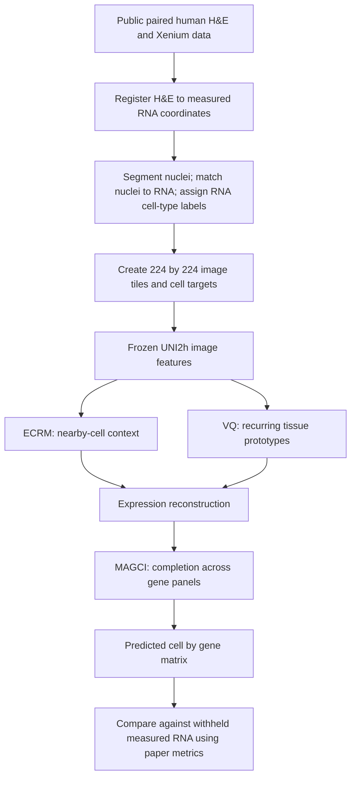

# GHIST+ paper reproduction workflow

The project baseline is **GHIST+**, the direct successor to GHIST. The target manuscript is **Generalisable tissue-wide molecular reconstruction from histology**, bioRxiv v1, posted **12 June 2026**, DOI **10.64898/2026.06.09.731252**. This is the latest direct successor identified in the 22 October 2026 check. It remains a preprint in the official metadata checked here.

The model is held fixed. The goal at this stage is to reproduce the paper's experiments and metrics. GHIST and SpatialEx appear only as the manuscript's comparison methods.

## 1. Understand the two workflows

### Model workflow



Training uses measured RNA as supervision. At deployment the expression predictions are inferred from H&E, nuclei information and the trained model. The paper's anchored broadcasting experiment additionally supplies measured RNA from selected tissue cores; its zero-shot setting does not use those target-core measurements. These two modes must be evaluated separately.

A nucleus is the image location used for the cell prediction. It is not a direct measurement of that cell's RNA.

### Reproduction workflow

**Pin manuscript and code → obtain original data and fold assignments → reproduce preprocessing → train the published experiment → predict its held-out tissue → calculate only the paper's metrics → compare observed results with the paper's reported values.**

The already completed notebook run starts at the evaluation end of this sequence, using released predictions. It does not substitute for model training, fresh inference, or numerical agreement with the manuscript.

## 2. Pin the exact sources

- Manuscript: `local_artifacts/paper/GHIST_plus_2026_06_09_731252v1.pdf`.
- Manuscript checksum, metrics and experiment definitions: `reproduction/paper_protocol/protocol.json`.
- Official code: https://github.com/SydneyBioX/GHIST_plus at commit `c5c895174c19903cc27d2661934b9b726bdb9306`.
- Official released data: https://huggingface.co/datasets/SydneyBioX/GHIST-Plus-bundle at revision `37a937677c5a8ebe5c7b8fbd486fbc5bb50ce1de`.

The paper predates this public code release. The repository history explicitly records figure revisions. A commit being official does not establish that it is the code that generated every manuscript figure.

## 3. Obtain the paper's real datasets

The manuscript's Table1 lists 15 processed Xenium slides from breast, colorectal, lung and pancreas. Use the exact 10x dataset links in PDF page15. BreastCancer2 is the held-out breast slide for the cross-slide study; PancreasADC3 is the held-out pancreas slide for the pan-cancer study.

For each model slide, prepare:

1. Registered H&E image.
2. Nucleus instance mask, with a unique ID for each nucleus.
3. Nucleus coordinates and matching metadata linking those IDs to Xenium cells.
4. The complete measured cell-by-gene matrix, not only the ten masked genes.
5. Cell-type labels from the paper's scClassify/reference workflow.
6. Gene-panel availability mask and the original train/validation/test assignments.

Keep measured zero counts separate from genes absent from a panel. Keep original library sizes for the manuscript's normalized-expression metrics. No synthetic cells or gene-expression measurements are needed. Masking measured genes is a held-out evaluation on real data, not generation of synthetic RNA.

The existing 10.9 GB download supplies evaluation inputs and released predictions. It does not supply all aligned images, masks, full-panel imputation matrices, GTEx objects and original five-fold assignments needed for the complete manuscript.

## 4. Repeat preprocessing

Follow the previous GHIST preprocessing referenced by GHIST+, rather than designing a replacement pipeline:

- Register H&E to the molecular coordinate frame.
- Apply the paper's HoVerNet segmentation and nucleus/RNA matching workflow.
- Use the tissue-appropriate RNA reference and scClassify for labels.
- Apply Macenko stain normalization and per-channel RGB standardization for the model experiments.
- Create 224×224 image tiles: no overlap during training and 30 pixels during validation/inference.
- Keep tiles containing at least one nucleus.
- Use horizontal/vertical flips, right-angle rotations and HED colour augmentation during training.

The separate GTEx HoVerNet preprocessing description uses its own 2000×2000 tiling and overlapping segmentation windows. Do not confuse segmentation-window sizes with the model's 224×224 tiles.

## 5. Use the manuscript's training settings

| Setting | Manuscript value |
| --- | --- |
| Epochs | 30 |
| Batch size | 64 |
| Learning rate | 0.001 |
| Weight decay | 0.0001 |
| First/second moment parameters | 0.9 / 0.999 |
| UNI2h image backbone | Frozen |
| Within-patch / cross-patch neighbour counts | 12 / 8 |
| VQ prototypes | 64 |
| Within-slide evaluation | Five spatial folds; 80% training and 20% validation in each |
| Cross-slide evaluation | Entire independent target slide withheld |

The released configurations use learning rate 0.00115 and weight decay 0.00001, and list one validation division. The templates in `reproduction/paper_protocol/config_templates/` restore the explicitly stated optimizer settings. **They are templates, not archived original manuscript configurations.** Their remaining parameters come from the public code and still need confirmation against the manuscript experiments.

The original five-fold boundaries/manifests remain missing. Do not loop `--fold_id 1..5` over a configuration containing one division: the current loader can reuse that same division instead of producing five distinct folds.

The paper reports an RTX A6000 with 48 GB VRAM. Its reported model-training times are approximately 2 hours for the single breast slide, 72 hours for breast multi-slide training and 120 hours for pan-cancer training. These are author-reported runtimes, not local measurements or guaranteed requirements.

## 6. Run each paper experiment separately

| Manuscript experiment | Data split and action | What to report |
| --- | --- | --- |
| Fig2, core-to-whole-slide | Compare zero-shot with measured core anchors, 0.5–3.5 mm²; evaluate withheld tissue | Gene PCC and pathway correlation; preserve ssGSEA setup |
| Fig3a–b, within-slide | BreastCancer2, original five spatial folds | Per-gene PCC and SSIM for the plotted gene subsets |
| Fig3c–g, breast transfer | Train BreastCancer1, IDC, IDC2, ILC and IDC3; evaluate BreastCancer2 | PCC, CMD, eight-class AUROC, spatial IoU and maps |
| Fig4a,b,d, imputation | Hide top ten Giotto-ranked measured genes on each of five breast slides from inputs and loss | PCC, SSIM, RMSE, CMD, TISSUE score; ERBB2/TPD52 maps |
| Fig4c, VQ ablation | Reproduce full, no-VQ and random-prototype variants on the same evaluation data | Per-gene PCC; do not substitute a different later intervention |
| Fig5a, pancreas transfer | Compare pancreas-only training with pan-cancer-assisted training; hold out PancreasADC3 | PCC for the stated SVG/non-SVG groups |
| Fig5b–f, normal breast | Apply to 77 female GTEx samples; reproduce OASIS/scClassify/BANKSY and age models | Compartments, cell proportions, ECM scores, regression estimates/P-values |

### Example model commands after the missing inputs are resolved

Use a separate environment following the official Linux/CUDA installation instructions. UNI2-H requires approved access through https://huggingface.co/MahmoodLab/UNI2-h . Obtain its official weights in the Hugging Face cache; do not replace them with random weights.

```sh
# GHIST_DATA_ROOT must point to the actual prepared image/RNA dataset.
export GHIST_DATA_ROOT="/path/to/prepared/real/data"

# These commands illustrate one fold. Supply the original five-fold assignments
# and repeat the model experiments on those five distinct folds for a full match.
python train.py \
  --config_file reproduction/paper_protocol/config_templates/within_slide.json \
  --fold_id 1 --gpu_id 0

python train.py \
  --config_file reproduction/paper_protocol/config_templates/breast_transfer.json \
  --fold_id 1 --gpu_id 0

python train_gene_mask_imputer.py \
  --config_file reproduction/paper_protocol/config_templates/imputation.json \
  --fold_id 1 --gpu_id 0

python train.py \
  --config_file reproduction/paper_protocol/config_templates/pancancer.json \
  --fold_id 1 --gpu_id 0
```

The pancreas template uses `config_pancancer.json` as its source. The file named `config_all_cancers.json` currently lists only breast training sources; its filename alone must not determine the experiment.

For prediction use the authors' `tools/inference.py` with the actual run directory, saved checkpoint, correct slide ID and run-specific imputation cache. Those paths are produced during training and must not be guessed. Running a command is not evidence of reproducing an experiment until its input/split/scale match has been checked.

## 7. Calculate the paper metrics consistently

| Metric | Plain meaning | Direction and scope |
| --- | --- | --- |
| PCC | Do predicted and measured expression vary together across cells? | Higher; one value per gene |
| Spearman correlation | Do expression rankings agree? | Higher; described in Methods and pathway evaluation |
| RMSE | How large are expression errors on the paper's scale? | Lower; use Eq15 normalization |
| SSIM | Do spatial expression patterns look similar numerically? | Higher; same binning/smoothing/cropping |
| CMD | Is gene co-expression structure preserved? | Lower; compare correlation matrices |
| TISSUE score | Error scaled by local variability | Preserve the manuscript definition/aggregation; not interval coverage |
| AUROC | Do marker scores distinguish one cell type from the others? | Higher; eight types in the main figure |
| Recall | How many true members of each class are recovered? | Higher; class-average definition in Methods |
| Spatial IoU | Do predicted and observed cell-type regions overlap? | Higher; 150 µm bins, Gaussian sigma1.2 |

For RMSE, the manuscript uses `log(1 + 10000 × expression / library_size)`. A number computed from `log(1 + raw_count)` is not on the same scale. Full measured panels/library sizes are required to implement the manuscript calculation.

Giotto ranking defines SVGs; Scanpy dispersion defines HVGs. HVGs and non-SVGs are different selections. Figure3b and Figure4c have inconsistent caption/axis labels, so preserve the ambiguity until the original analysis is identified. Never select a gene subset because it makes the result closer to the published target.

Save per-gene/per-class results and cohort counts, then reproduce the paper's aggregation. Keep an undefined correlation undefined rather than changing it to zero without a stated convention. Do not add new benchmark models, a new common-gene cohort, or an overall percent-accuracy claim.

## 8. What is executable locally now

From this repository root:

```sh
# The existing isolated analysis environment is already installed.
../work/ghist_plus_reproduction/.venv/bin/python reproduction/fetch_paper.py
../work/ghist_plus_reproduction/.venv/bin/python reproduction/prepare_paper_templates.py
../work/ghist_plus_reproduction/.venv/bin/python reproduction/paper_only.py
```

These verified commands generate the paper-only report and metric tables from the pinned manuscript and previously executed official notebooks. They do not perform fresh training. Main outputs:

- `reproduction/REPORT.md`: current manuscript-scoped status.
- `reproduction/paper_protocol/paper_values.csv`: values transcribed from the paper with page/figure references.
- `results/paper_only/paper_vs_released.csv`: manuscript versus released-code values; mismatches remain visible.
- `results/paper_only/Figure3*.csv`: paper metric names and panel mapping, limited to the paper's comparison methods.
- `results/paper_only/paper_scope_receipt.json`: sources, hashes and the explicit incomplete status.

Current status: released-notebook evaluation completed; exact manuscript numerical reproduction, original five-fold training, fresh H&E inference and the full GTEx analysis remain unfinished. The manuscript values are reference targets, never substituted for local measurements.
